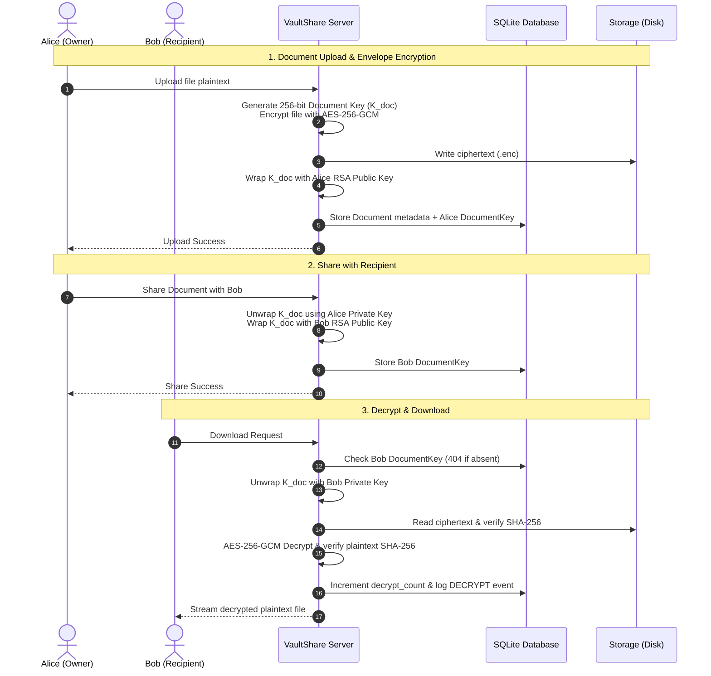

# VaultShare

VaultShare is a zero-knowledge secure document distribution web application built with Python, Flask, SQLite, and the `cryptography` library. It enables users to upload documents encrypted at rest with AES-256-GCM, securely distribute wrapped symmetric keys to designated recipients using RSA-3072 / RSA-OAEP, track document access metrics in real-time, instantly revoke access, and verify data integrity via an append-only, hash-chained audit log protected by database-level immutability triggers.

---

## Features

- **Zero-Knowledge Keypair Generation**: Generates RSA-3072 keypairs on registration. The private key is encrypted with AES-256-GCM using a key derived from the user's password via `scrypt` ($N=2^{15}, r=8, p=1$). The plaintext private key is never written to disk, logged, or flashed.
- **Envelope Encryption at Rest**: Every uploaded file is encrypted with a unique 256-bit AES-GCM symmetric document key and a 96-bit random nonce. Encrypted files are stored on disk under cryptographically random filenames (`*.enc`).
- **Multi-Recipient Asymmetric Key Distribution**: Document keys are wrapped for recipients using RSA-OAEP (SHA-256 digest, MGF1). Sharing encrypts the document key with the recipient's RSA public key without re-encrypting the underlying file content.
- **Multi-Stage Cryptographic Integrity Verification**: Ordered 5-stage verification checks:
  1. Stored file presence and storage path containment
  2. Ciphertext SHA-256 digest match
  3. RSA key unwrapping via unlocked session private key
  4. AES-256-GCM authentication tag verification and decryption
  5. Decrypted plaintext SHA-256 digest match
- **Access Tracking & Instant Revocation**: Tracks recipient decryption count and timestamp. Revocation immediately deletes the recipient's `DocumentKey` record, preventing further decryptions.
- **Silent 404 Access Control ("404-not-403")**: Unauthorized attempts to access, manage, or download documents return silent HTTP 404 responses rather than 403 Forbidden to prevent enumeration of document existence.
- **Tamper-Evident Hash-Chained Audit Log**: Every sensitive action is cryptographically chained using SHA-256 hashes computed over canonical JSON representations. SQLite `BEFORE UPDATE` and `BEFORE DELETE` triggers reject database-level tampering.
- **Security Hardening**:
  - Content Security Policy (CSP) blocking inline scripts and eval
  - Subresource Integrity (SRI) on external assets
  - Session fixation defense and CSRF protection on all state-altering requests
  - In-memory unlocked private key cache with 30-minute idle expiration
  - Rate limiting (Flask-Limiter) and automatic account lockout after 5 failed attempts in 15 minutes
  - Formula-injection sanitization for CSV activity exports

---

## Architecture & Cryptographic Design

VaultShare employs a hybrid envelope encryption architecture combining symmetric encryption for bulk file data and asymmetric cryptography for multi-recipient access management:

1. **User Keypair & Password Derivation**:
   - Each user receives an RSA-3072 keypair upon registration.
   - The user's private key is encrypted using AES-256-GCM with a key derived from their plaintext password using `scrypt` ($N=32768, r=8, p=1$, 128-bit random salt).
   - Upon authentication, the private key is decrypted into a server-side in-memory cache keyed by a random session token.
2. **Document Encryption (AES-256-GCM)**:
   - For each upload, a fresh 256-bit symmetric document key ($K_{\text{doc}}$) and 96-bit nonce are generated.
   - Plaintext is encrypted with AES-256-GCM, and ciphertext is written to `storage/<random_token>.enc`.
   - Plaintext SHA-256 and ciphertext SHA-256 digests are computed and stored in the database.
3. **Key Distribution (RSA-OAEP)**:
   - $K_{\text{doc}}$ is wrapped for the owner and each authorized recipient using RSA-OAEP with SHA-256 and MGF1.
   - Wrapped keys are stored in the `document_keys` table.
4. **Decryption & Download**:
   - The recipient's unlocked RSA private key unwraps their copy of $K_{\text{doc}}$.
   - The server verifies ciphertext integrity, decrypts the file, authenticates the GCM tag, verifies the plaintext digest, increments the recipient's `decrypt_count`, logs a `DECRYPT` event, and streams the decrypted file.
5. **Access Revocation**:
   - The document owner deletes the recipient's `DocumentKey` row from the database.
   - Subsequent download attempts return HTTP 404 and record an `ACCESS_DENIED` event.
6. **Audit Log Hash Chain**:
   - Each `AuditLog` row contains `prev_hash` and `entry_hash`.
   - Entry hash is calculated as $\text{SHA-256}(\text{prev\_hash} \parallel \text{canonical\_json}(\text{fields}))$, chained from a 64-zero genesis hash (`"0"*64`).
   - Immutability triggers abort any attempt to update or delete rows.



---

## Tech Stack

- **Runtime & Language**: Python 3.13
- **Web Framework**: Flask 3.1.3 (Application Factory Pattern)
- **Database & ORM**: SQLite 3, Flask-SQLAlchemy 3.1.1, SQLAlchemy 2.1.8
- **Authentication & Security**: Flask-Login 0.6.3, Flask-WTF 1.3.0, Flask-Limiter 4.1.1
- **Cryptography**: `cryptography` 50.0.2 (AES-256-GCM, RSA-3072, RSA-OAEP, scrypt)
- **Frontend**: Jinja2 3.1.6, Bootstrap 5.3 (CDN), Bootstrap Icons
- **Testing & Security Audit**: `pytest` 9.2.0, `pip-audit` 2.10.1

---

## Setup & Installation on Windows (PowerShell)

### 1. Prerequisites
- Python 3.13 installed and accessible from PowerShell.

### 2. Create and Activate Virtual Environment
```powershell
py -3.13 -m venv venv
.\venv\Scripts\Activate.ps1
```

### 3. Install Dependencies
```powershell
pip install -r requirements.txt
```

### 4. Configure Environment Variables
Copy `.env.example` to `.env`:
```powershell
Copy-Item .env.example .env
```
Ensure `SECRET_KEY` is defined in `.env`:
```ini
SECRET_KEY="replace-with-a-random-32-character-secret-key"
FLASK_APP="wsgi.py"
FLASK_CONFIG="development"
STORAGE_DIR="storage"
```

### 5. Initialize the Database
```powershell
flask init-db
```

### 6. Run the Application
```powershell
flask run
```
Open [http://127.0.0.1:5000](http://127.0.0.1:5000) in your web browser.

---

## Verification, Testing, and Demo

### Running Automated Checks
To run the full test suite, verify the audit log hash chain, and execute dependency vulnerability audits:
```powershell
.\scripts\run_checks.ps1
```

### Running Tests Directly
```powershell
python -m pytest -q
```

### Verifying Audit Log Cryptographic Integrity
```powershell
flask verify-audit
```

### Seeding Demo Data
To reset and seed the database with standard demo accounts (`alice`, `bob`, `carol` sharing the policy-compliant password `DemoVaultPass2026!#`) and simulated activity:
```powershell
flask reset-db --yes
flask seed-demo
```
For a complete step-by-step walkthrough of the live demo presentation script, see [docs/DEMO.md](docs/DEMO.md).

---

## Project Structure

```
VaultShare/
├── .env.example              # Environment variables template
├── .gitattributes            # Git line-ending configuration
├── .gitignore                # Git ignore patterns
├── config.py                 # Multi-environment configuration classes
├── README.md                 # Project documentation
├── requirements.txt          # Python package dependencies
├── run.py                    # Direct development entry point
├── wsgi.py                   # Production / WSGI application entry point
├── app/
│   ├── __init__.py           # Application factory, CLI commands, extensions
│   ├── access.py             # Access control guards and silent 404 handlers
│   ├── activity.py           # Activity query filters, formatting, CSV export
│   ├── audit.py              # Audit log hash-chain logic and verification
│   ├── audit_routes.py       # Audit log view blueprints
│   ├── auth.py               # Authentication routes, key unlocking, lockout
│   ├── crypto.py             # AES-GCM, RSA-3072, OAEP, scrypt primitives
│   ├── documents.py          # Document upload, sharing, decryption, revocation
│   ├── forms.py              # Flask-WTF validation forms and password policy
│   ├── integrity.py          # Multi-stage file and hash chain verification
│   ├── keycache.py           # Server-side in-memory unlocked private key cache
│   ├── main.py               # Landing page, dashboard, and activity routes
│   ├── models.py             # SQLAlchemy models and SQLite immutability triggers
│   ├── static/
│   │   ├── css/app.css       # Custom styles
│   │   └── js/app.js         # Unobtrusive JavaScript handlers
│   └── templates/
│       ├── base.html         # Base layout with Bootstrap 5
│       ├── dashboard.html    # User dashboard
│       ├── index.html        # Landing page
│       ├── activity/         # Activity log templates
│       ├── auth/             # Login and registration templates
│       ├── documents/        # Upload, manage, and listing templates
│       ├── errors/           # Custom HTTP error pages (400, 401, 403, 404, 405, 413, 429, 500)
│       └── integrity/        # Integrity verification dashboard
├── docs/
│   ├── DEMO.md               # Step-by-step live demonstration script
│   └── security-notes.md     # Detailed security architecture & threat analysis
├── scripts/
│   ├── run_checks.ps1        # Automated test, audit, and security runner
│   ├── tamper_audit_demo.py  # Audit log tampering simulation script
│   └── tamper_demo.py        # Ciphertext tampering simulation script
└── tests/
    ├── conftest.py           # Pytest fixtures and app factories
    ├── test_activity.py      # Activity history and CSV export tests
    ├── test_audit_chain.py   # Hash-chain integrity and immutability tests
    ├── test_auth.py          # Authentication, key generation, and lockout tests
    ├── test_crypto.py        # Cryptographic primitives unit tests
    ├── test_dashboard.py     # Dashboard metrics and permission tests
    ├── test_e2e_demo_flow.py # End-to-end demo story automated test
    ├── test_integrity.py     # Multi-stage verification tests
    ├── test_models.py        # Model constraint and relation tests
    ├── test_security.py      # Hardening, headers, rate limits, CSP tests
    ├── test_seed.py          # Seed-demo and reset-db CLI tests
    ├── test_sharing.py       # Multi-recipient sharing and revocation tests
    ├── test_smoke.py         # Smoke tests and routing tests
    └── test_upload.py        # Upload, validation, and storage tests
```

---

## Route Table

Generated directly from application URL map (`app.url_map`):

| Method | Path | Purpose | Access Rule |
| :--- | :--- | :--- | :--- |
| `GET` | `/` | Landing / home page | Public |
| `GET` | `/dashboard` | User dashboard with stats & recent events | Authenticated |
| `GET` | `/activity` | Activity audit trail with filtering and pagination | Authenticated |
| `POST` | `/activity/export` | Export filtered activity logs as CSV | Authenticated, CSRF |
| `GET, POST` | `/auth/register` | Register account & generate RSA-3072 keypair | Public, Rate Limit (5/hr) |
| `GET, POST` | `/auth/login` | Authenticate & unlock private key into cache | Public, Rate Limit (5/min) |
| `POST` | `/auth/logout` | Discard unlocked key & terminate session | Authenticated, CSRF |
| `GET` | `/documents` | List owned documents & documents shared with user | Authenticated |
| `GET, POST` | `/documents/upload` | Upload & AES-256-GCM encrypt a document | Authenticated, CSRF |
| `GET` | `/documents/<int:doc_id>/manage` | Manage document recipients and view decrypt counts | Document Owner only |
| `POST` | `/documents/<int:doc_id>/share` | Distribute wrapped key to designated recipients | Document Owner only, CSRF, Rate Limit (30/min) |
| `POST` | `/documents/<int:doc_id>/revoke/<int:user_id>` | Revoke recipient access by deleting DocumentKey | Document Owner only, CSRF |
| `POST` | `/documents/<int:doc_id>/download` | Decrypt and stream authorized document | Authorized Recipient only, CSRF, Rate Limit (30/min) |
| `GET` | `/documents/<int:doc_id>/activity` | View audit trail filtered for a specific document | Document Owner only |
| `GET` | `/integrity` | Document & audit log cryptographic integrity page | Authenticated |
| `POST` | `/integrity/documents/<int:doc_id>/verify` | Execute 5-stage cryptographic integrity check | Authorized Recipient only, CSRF |
| `POST` | `/integrity/documents/<int:doc_id>/check-file` | Check local file copy against stored plaintext hash | Authorized Recipient only, CSRF |
| `POST` | `/integrity/verify-all` | Batch-verify all accessible documents | Authenticated, CSRF |
| `POST` | `/integrity/audit-chain/verify` | Verify cryptographic continuity of audit hash chain | Authenticated, CSRF |
| `GET` | `/static/<path:filename>` | Serve static stylesheets and scripts | Public |

---

## Security Documentation

For detailed analysis of implemented security mitigations, threat boundaries, and defensive controls, see [docs/security-notes.md](docs/security-notes.md).

---

## Known Limitations

1. **Server-Side Decryption (Not End-to-End Encryption)**:
   - Decryption takes place server-side in application memory. While private keys and documents are encrypted at rest, the server acts as a trusted processing intermediary. If the server process or host OS is compromised while user sessions are active, cached private keys and in-transit plaintext could be accessed by an attacker.
2. **Access Revocation Cannot Recall Downloaded Copies**:
   - Revoking access deletes the recipient's wrapped `DocumentKey` row from the database, preventing future decryption via VaultShare. However, it cannot retroactively purge, delete, or recall document copies previously downloaded to a recipient's local machine.
3. **Forgotten Passwords Are Unrecoverable by Design**:
   - Because a user's RSA private key is encrypted with an AES key derived from their password via `scrypt`, a forgotten password permanently prevents decryption of their private key and documents. Password reset is intentionally not implemented.
4. **Audit Chain Tail Truncation**:
   - The SHA-256 hash chain and SQLite triggers detect any modification, deletion, or insertion within the audit log. However, deleting the most recent entries from the end of the log (tail truncation) leaves an internally valid hash chain prefix. Full protection against tail truncation requires periodic anchoring of the latest head hash to an external witness or timestamping service.
