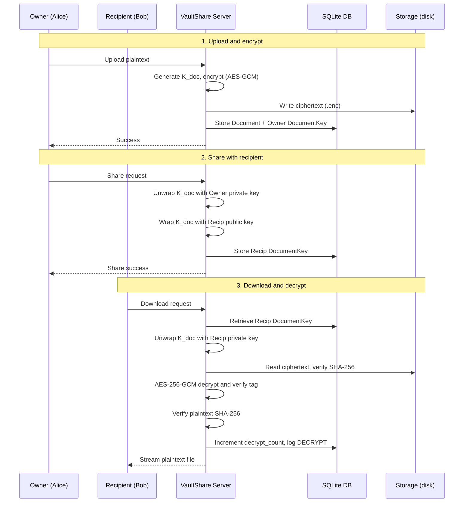

# VaultShare

VaultShare is a secure document distribution web application built with Python, Flask, SQLite, and the `cryptography` library. It enables users to upload documents **encrypted at rest with AES-256-GCM**, securely distribute wrapped symmetric keys to designated recipients using RSA-3072 / RSA-OAEP, track document access metrics in real-time, instantly revoke access, and verify data integrity via an **append-only audit log, enforced by SQLite triggers**.

## Live Demo

[https://vaultshare-xt4v.onrender.com](https://vaultshare-xt4v.onrender.com) - hosted on Render's free tier. First load after inactivity can take 30-60 seconds, and data resets on restarts, so do not upload real or sensitive documents.

**Try it:** Register a new account to explore the application. No pre-created demo credentials are provided.

---

## Features

- **Encrypted Private Key Storage**: Generates an RSA-3072 keypair on registration. The private key is encrypted with AES-256-GCM using a key derived from the user's password via `scrypt` (per-user random salt). The plaintext private key is never written to disk.
- **Envelope Encryption at Rest**: Every uploaded file is encrypted with a unique 256-bit AES-GCM symmetric document key and a 96-bit random nonce. Encrypted files are stored on disk under cryptographically random filenames (`*.enc`).
- **Multi-Recipient Asymmetric Key Distribution**: Document keys are wrapped for recipients using RSA-OAEP (SHA-256 digest, MGF1). Sharing encrypts the document key with the recipient's RSA public key without re-encrypting the underlying file content.
- **Multi-Stage Cryptographic Integrity Verification**: Ordered 5-stage verification checks:
  1. Stored file presence and storage-path containment
  2. Ciphertext SHA-256 digest match
  3. RSA key unwrapping via unlocked session private key
  4. AES-256-GCM authentication tag verification and decryption
  5. Decrypted plaintext SHA-256 digest match
- **Access Tracking & Instant Revocation**: Tracks recipient decryption count and timestamp. Revocation immediately deletes the recipient's `DocumentKey` record, preventing further decryptions.
- **Silent 404 Access Control ("404-not-403")**: Unauthorized attempts to access, manage, or download documents return silent HTTP 404 responses rather than 403 Forbidden to prevent enumeration of document existence.
- **Tamper-Evident Append-Only Audit Log**: Each `AuditLog` row stores `prev_hash` and `entry_hash`, both computed via SHA-256 over a canonical JSON representation of the entry. SQLite `BEFORE UPDATE` and `BEFORE DELETE` triggers abort any attempt to modify or delete rows, making the log append-only.
- **Security Hardening**:
  - Content Security Policy (CSP) blocking inline scripts and eval
  - Subresource Integrity (SRI) on external CDN assets (Bootstrap CSS and JS)
  - Session fixation defense and CSRF protection on all state-altering requests
  - In-memory unlocked private-key cache with 30-minute idle expiration
  - Rate limiting (Flask-Limiter) and automatic account lockout after **5 failed attempts** within **15 minutes**
  - Formula-injection sanitization for CSV activity exports (prefixes `'` on cells starting with `=`, `+`, `-`, `@`, tab, or CR)

---

## Architecture & Cryptographic Design

VaultShare employs a hybrid envelope encryption architecture combining symmetric encryption for bulk file data and asymmetric cryptography for multi-recipient access management:

1. **User Keypair & Password Derivation**:
   - Each user receives an RSA-3072 keypair upon registration.
   - The user's private key is encrypted using AES-256-GCM with a key derived from their plaintext password using `scrypt` (N=2^15, r=8, p=1) and a per-user random salt.
   - Upon authentication, the private key is decrypted into a server-side in-memory cache keyed by a random session token.
2. **Document Encryption (AES-256-GCM)**:
   - For each upload, a fresh 256-bit symmetric document key (K_doc) and 96-bit nonce are generated.
   - Plaintext is encrypted with AES-256-GCM; ciphertext is written to `storage/<random>.enc`.
   - Plaintext and ciphertext SHA-256 digests are stored in the database.
3. **Key Distribution (RSA-OAEP)**:
   - K_doc is wrapped for the owner and each authorized recipient using RSA-OAEP with SHA-256 and MGF1.
   - Wrapped keys are stored in the `document_keys` table.
4. **Decryption & Download**:
   - The recipient's unlocked RSA private key unwraps their copy of K_doc.
   - The server verifies ciphertext integrity, decrypts the file, authenticates the GCM tag, verifies the plaintext digest, increments the recipient's `decrypt_count`, logs a `DECRYPT` event, and streams the decrypted file.
5. **Access Revocation**:
   - The document owner deletes the recipient's `DocumentKey` row from the database.
   - Subsequent download attempts return HTTP 404 and record an `ACCESS_DENIED` event.
6. **Audit Log Hash Chain**:
   - Each `AuditLog` row contains `prev_hash` and `entry_hash`.
   - `entry_hash` = SHA-256(prev_hash || canonical_json(fields)), chained from a 64-zero genesis hash.
   - Append-only triggers abort any attempt to update or delete rows.



---

## Tech Stack

- **Runtime & Language**: Python 3.13
- **Web Framework**: Flask 3.1.3 (application-factory pattern)
- **Database & ORM**: SQLite 3, Flask-SQLAlchemy 3.1.1, SQLAlchemy 2.1.8
- **Authentication & Security**: Flask-Login 0.6.3, Flask-WTF 1.3.0, Flask-Limiter 4.1.1
- **Cryptography**: `cryptography` 50.0.2 (AES-256-GCM, RSA-3072, RSA-OAEP, scrypt)
- **Frontend**: Jinja2 3.1.6, Bootstrap 5.3 (CDN), Bootstrap Icons
- **Testing & Security Audit**: `pytest` 9.2.0, `pip-audit` 2.10.1

---

## Setup & Installation on Windows (PowerShell)

### 1. Prerequisites
- Python 3.13 installed and accessible from PowerShell.

### 2. Create and Activate Virtual Environment
```powershell
py -3.13 -m venv venv
.\venv\Scripts\Activate.ps1
```

### 3. Install Dependencies
```powershell
pip install -r requirements.txt
```

### 4. Configure Environment Variables
Copy `.env.example` to `.env` and **ensure `SECRET_KEY` is defined** (production requires it; the app will refuse to start without a value).
```powershell
Copy-Item .env.example .env
```
Edit the file, e.g.:
```ini
SECRET_KEY="replace-with-a-strong-random-32-character-secret"
FLASK_APP="wsgi.py"
FLASK_CONFIG="development"
STORAGE_DIR="storage"
```

### 5. Initialize the Database (safe to run on every startup)
```powershell
flask --app wsgi init-db
```

### 6. Run the Application (development server)
```powershell
flask --app wsgi run
```
Open <http://127.0.0.1:5000> in your browser.

### 7. Run the Tests
```powershell
python -m pytest -v
```

To see ciphertext tamper-detection in action, `tamper_demo.py` flips a single byte in a `.enc` storage file and prints instructions to run the integrity check in the browser, where the ciphertext-hash stage will fail:
```powershell
python scripts/tamper_demo.py
```

*macOS / Linux:* replace `.\venv\Scripts\Activate.ps1` with `source venv/bin/activate`.

---

## Deployment

The application can be deployed to Render with the provided `render.yaml`. A **single-worker Gunicorn** process is required because the unlocked private-key cache lives in one process's memory; additional workers would not share the cache and could break decryption.

---

## Known Limitations

- Render free-tier disk is **ephemeral** - data is lost on restarts or inactivity-driven shutdowns.
- SQLite + local file storage limit scalability and concurrent access.
- Only a **single Gunicorn worker** is used (see above).
- No email verification or two-factor authentication is implemented.
- Server-side decryption means the server is a trusted party; if the host is compromised while sessions are active, cached keys and plaintext could be exposed.
